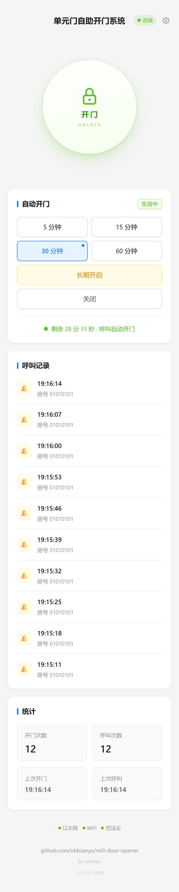
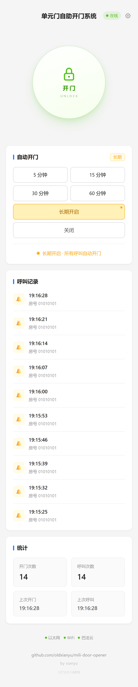
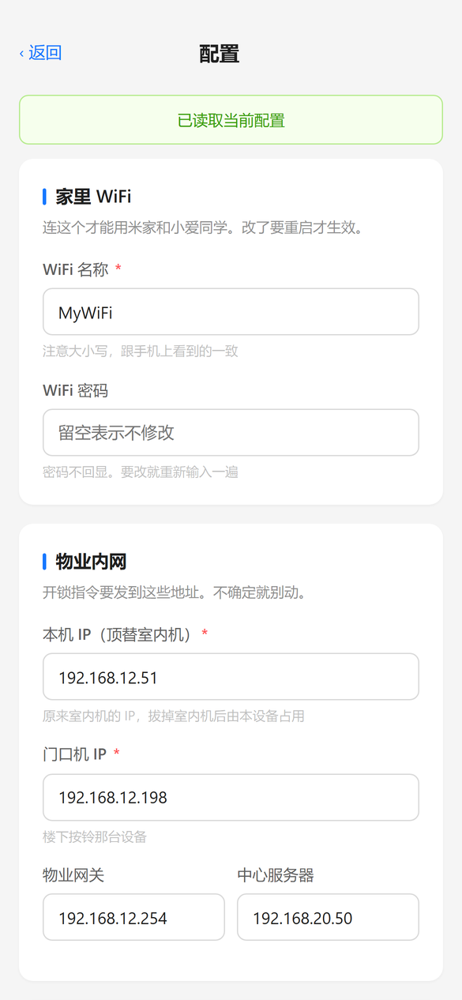

# 米立室内机 —— 手机 / 小爱同学远程开门

本项目代码已转为私有仓库。

---

逆向米立（MILi）室内机私有协议，用 ESP32 顶替室内机，实现手机网页 / 小爱同学远程开门。

  
  
  

  左：首页　中：长期开启　右：网页配置

---

## 免责声明

本项目仅供学习和研究使用，仅限操作自己家的设备。
不要用于他人设备或公共设施，使用前确认不违反当地法规和物业规定。
